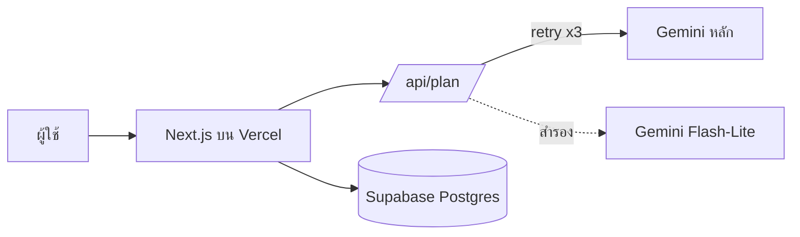

# TripMind – MVP Requirements

แพลตฟอร์มวางแผนเที่ยวด้วย AI (AI Tourism Itinerary Platform) รุ่น MVP ที่สร้างและรันได้ **ฟรี** ทั้งหมด

> สถานะ: Draft v0.1 · อัปเดต: 19 ต.ค. 2026

---

## 1. เป้าหมาย (Goals)

- ให้ผู้ใช้กรอกปลายทาง จำนวนวัน งบ และสไตล์การเที่ยว แล้วได้แผนเที่ยวรายวันภายในไม่กี่วินาที
- พิสูจน์ว่าผู้ใช้ "อยากใช้จริง" ก่อนลงทุนฟีเจอร์ใหญ่
- ต้นทุนรันระบบ = **0 บาท** ในช่วงทดลอง

**ไม่ใช่เป้าหมายของ MVP:** ระบบจองตั๋ว/โรงแรม, ชำระเงิน, แอปมือถือ, แผนที่แบบเรียลไทม์

## 2. กลุ่มผู้ใช้เป้าหมาย

| กลุ่ม | ความต้องการหลัก |
|---|---|
| นักท่องเที่ยวไทย เที่ยวเอง | ได้แผนเร็ว ไม่ต้องค้นหลายเว็บ |
| คู่รัก / ครอบครัว | แผนที่เหมาะกับงบและจำนวนคน |
| คนที่มีเวลาน้อย (ทริป 2–4 วัน) | จัดลำดับสถานที่ให้ไม่เสียเวลาเดินทาง |

## 3. Functional Requirements

### 3.1 Must have (ต้องมีใน MVP)

| ID | Requirement | เกณฑ์ยอมรับ (Acceptance Criteria) |
|---|---|---|
| F1 | ฟอร์มกรอกข้อมูลทริป | กรอกปลายทาง, จำนวนวัน (1–7), งบ, สไตล์ (เช่น ธรรมชาติ/อาหาร/วัฒนธรรม) ได้ และมี validation |
| F2 | สร้างแผนเที่ยวด้วย AI | กดปุ่ม "ค้นหาสถานที่ท่องเที่ยว" แล้วได้แผนรายวันแบบมีโครงสร้าง (JSON → แสดงผลเป็นการ์ด) ภายใน ≤ 20 วินาที |
| F3 | แสดงแผนรายวัน | แต่ละวันแสดงช่วงเวลา (เช้า/บ่าย/เย็น), ชื่อสถานที่, คำอธิบายสั้น, ค่าใช้จ่ายโดยประมาณ |
| F4 | จัดการ error ที่เป็นมิตร | ถ้า AI ไม่ว่าง ระบบลองใหม่อัตโนมัติ (สูงสุด 3 ครั้ง) และสลับโมเดลสำรอง แล้วค่อยแจ้งผู้ใช้ |
| F5 | บันทึกแผนขึ้น Cloud | กด "บันทึกขึ้น Cloud" แล้วข้อมูลถูกเก็บใน Supabase และเปิดดูได้อีกครั้ง |

### 3.2 Should have (ควรมี ถ้าเวลาพอ)

| ID | Requirement |
|---|---|
| F6 | ดูรายการแผนที่เคยบันทึก (My Trips) |
| F7 | แก้ไข/ลบแผนที่บันทึกไว้ |
| F8 | ปุ่มคัดลอกลิงก์ / แชร์แผนแบบอ่านอย่างเดียว |
| F9 | ลิงก์ไป Google Maps ของแต่ละสถานที่ |

### 3.3 Won't have (ยังไม่ทำ)

- ระบบสมาชิกเต็มรูปแบบ (เริ่มจากไม่ต้องล็อกอิน หรือใช้ anonymous session)
- จอง/ชำระเงิน, ระบบรีวิว, หลายภาษา (เริ่มภาษาไทยก่อน)
- Offline mode, push notification

## 4. Non-functional Requirements

| หมวด | ข้อกำหนด |
|---|---|
| ประสิทธิภาพ | หน้าแรกโหลด < 3 วินาที (4G), การสร้างแผน ≤ 20 วินาที |
| ความพร้อมใช้งาน | ทนต่อ AI ไม่ว่างด้วย retry + fallback model |
| ความปลอดภัย | API key เก็บใน Environment Variables เท่านั้น ห้าม commit ลง repo |
| Responsive | ใช้งานได้ดีบนมือถือ (ผู้ใช้ส่วนใหญ่เปิดจากมือถือ) |
| ความเป็นส่วนตัว | ไม่เก็บข้อมูลส่วนบุคคลเกินจำเป็น |
| ต้นทุน | อยู่ในโควตาฟรีของทุกบริการ |

## 5. Tech Stack (ฟรีทั้งหมด)

| ส่วน | เครื่องมือ | หมายเหตุฟรี |
|---|---|---|
| Frontend + API | Next.js (App Router) | โอเพนซอร์ส |
| Hosting | Vercel (Hobby) | ฟรีสำหรับโปรเจกต์ส่วนตัว/ทดลอง |
| AI | Google Gemini API (รุ่น Flash / Flash-Lite) | มีโควตาฟรี แต่มี rate limit |
| ฐานข้อมูล | Supabase (Free tier) | Postgres + Auth ในตัว |
| Source control / CI | GitHub | ฟรี |

### Environment Variables

| ตัวแปร | ใช้ทำอะไร |
|---|---|
| `GEMINI_API_KEY` | คีย์เรียก Gemini |
| `GEMINI_MODEL` | โมเดลหลัก (ตั้งค่าได้โดยไม่ต้องแก้โค้ด) |
| `GEMINI_FALLBACK_MODEL` | โมเดลสำรองเมื่อโมเดลหลักไม่ว่าง |
| `NEXT_PUBLIC_SUPABASE_URL` | URL ของ Supabase |
| `NEXT_PUBLIC_SUPABASE_ANON_KEY` | anon key ของ Supabase |

> ⚠️ ชื่อโมเดลของ Google เปลี่ยนบ่อย ตรวจรายชื่อล่าสุดที่ [Google AI Studio](https://aistudio.google.com) ก่อนตั้งค่า

## 6. สถาปัตยกรรมโดยย่อ



## 7. Data Model (ร่าง)

```sql
create table trips (
  id uuid primary key default gen_random_uuid(),
  created_at timestamptz default now(),
  destination text not null,
  days int not null check (days between 1 and 7),
  budget text,
  style text,
  plan jsonb not null   -- แผนรายวันที่ AI สร้าง
);
```

## 8. User Flow หลัก

1. เปิดเว็บ → กรอกฟอร์ม (ปลายทาง / วัน / งบ / สไตล์)
2. กด **ค้นหาสถานที่ท่องเที่ยว** → ระบบเรียก AI
3. ดูแผนรายวัน
4. กด **บันทึกขึ้น Cloud** → เก็บลง Supabase
5. (ถัดไป) เปิดดูแผนที่บันทึกไว้ / แชร์ลิงก์

## 9. ความเสี่ยงและแนวทางรับมือ

| ความเสี่ยง | ผลกระทบ | แนวทางรับมือ |
|---|---|---|
| AI ไม่ว่าง / โดน rate limit | ผู้ใช้ไม่ได้แผน | retry + fallback model + แคชผลลัพธ์ |
| โมเดลถูกเลิกให้บริการ | ระบบพังกะทันหัน | อ่านชื่อโมเดลจาก env var, ตรวจ AI Studio เป็นระยะ |
| AI แต่งข้อมูลผิด (hallucination) | สถานที่/ราคาไม่ตรงจริง | แสดงข้อความ "ข้อมูลโดยประมาณ" และใส่ลิงก์ Maps ให้ตรวจสอบ |
| เกินโควตาฟรี | บริการหยุด | จำกัดจำนวนครั้งต่อผู้ใช้, แสดงข้อความรอลองใหม่ |
| ทำคีย์หลุด | ถูกใช้โควตา | ใช้ env var เท่านั้น, ตั้ง `.gitignore` ให้ครอบคลุม |

## 10. เกณฑ์สำเร็จของ MVP (Success Metrics)

- [ ] สร้างแผนสำเร็จ ≥ 90% ของการกดทั้งหมด
- [ ] เวลาสร้างแผนเฉลี่ย ≤ 20 วินาที
- [ ] ผู้ทดสอบ ≥ 10 คน ให้คะแนนความพอใจ ≥ 4/5
- [ ] ≥ 30% ของผู้ใช้กดบันทึกแผน
- [ ] ต้นทุนรวม = 0 บาท

## 11. Roadmap

| ระยะ | สิ่งที่ทำ |
|---|---|
| **MVP (ตอนนี้)** | F1–F5: ฟอร์ม, สร้างแผน, แสดงผล, retry/fallback, บันทึก Cloud |
| **v0.2** | My Trips, แก้ไข/ลบ, ลิงก์ Google Maps |
| **v0.3** | แชร์แผน, ล็อกอิน (Supabase Auth) |
| **v1.0** | แผนที่, ประมาณงบละเอียด, หลายภาษา |
