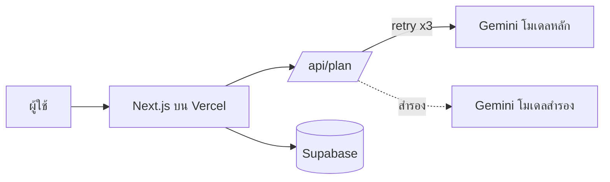

# 🧭 TripMind

แพลตฟอร์มวางแผนเที่ยวด้วย AI (AI Tourism Itinerary Platform) กรอกปลายทาง จำนวนวัน งบ และสไตล์การเที่ยว แล้วได้แผนเที่ยวรายวันในไม่กี่วินาที

🌐 **Live Demo:** https://tripmind-nine.vercel.app

📋 **เอกสารความต้องการ:** [MVP Requirements](./MVP_REQUIREMENTS.md)

---

## ✨ ฟีเจอร์หลัก (MVP)

- กรอกข้อมูลทริป: ปลายทาง, จำนวนวัน, งบ, สไตล์การเที่ยว
- สร้างแผนเที่ยวรายวันด้วย AI
- ลองเรียก AI ซ้ำอัตโนมัติเมื่อเซิร์ฟเวอร์ไม่ว่าง และสลับไปใช้โมเดลสำรอง
- บันทึกแผนขึ้น Cloud

## 🛠️ ภาษาและเทคโนโลยีที่ใช้

### ภาษา (Languages)

| ภาษา | ใช้ทำอะไร |
|---|---|
| **JavaScript (ES6+)** | เขียนทั้งหน้าเว็บและ API (เช่น `app/api/plan/route.js`) |
| **JSX** | เขียนส่วนติดต่อผู้ใช้ด้วย React |
| **HTML / CSS** | โครงสร้างและหน้าตาของหน้าเว็บ |
| **SQL** | สร้างและจัดการตารางฐานข้อมูลบน Supabase (PostgreSQL) |

### เทคโนโลยี (Tech Stack)

| ส่วน | เทคโนโลยี | หน้าที่ |
|---|---|---|
| Framework | [Next.js](https://nextjs.org) (App Router) | สร้างหน้าเว็บและ API route ในโปรเจกต์เดียว |
| UI Library | [React](https://react.dev) | สร้างหน้าจอแบบ component |
| Runtime | [Node.js](https://nodejs.org) | รันโค้ดฝั่งเซิร์ฟเวอร์ |
| AI | [Google Gemini API](https://ai.google.dev) | สร้างแผนเที่ยวในรูปแบบ JSON |
| Database | [Supabase](https://supabase.com) (PostgreSQL) | เก็บแผนที่ผู้ใช้บันทึก |
| Hosting / Deploy | [Vercel](https://vercel.com) | โฮสต์เว็บและ deploy อัตโนมัติเมื่อ push ขึ้น GitHub |
| Source Control | [GitHub](https://github.com) | เก็บโค้ดและเชื่อมกับ Vercel |

> ทุกบริการที่ใช้อยู่ในโควตาฟรี (free tier) ในช่วงทดลอง

## 🧩 สถาปัตยกรรมโดยย่อ



## 📁 โครงสร้างโปรเจกต์

```
tripmind/
└── tripmind-next/
    ├── app/
    │   ├── page.js            # หน้าเว็บหลัก
    │   └── api/
    │       └── plan/
    │           └── route.js   # API สร้างแผนเที่ยว (เรียก Gemini)
    ├── package.json
    └── ...
```

## 🚀 วิธีรันในเครื่อง

```bash
# 1. โคลนโปรเจกต์
git clone https://github.com/sretthapongarm-arch/tripmind.git
cd tripmind/tripmind-next

# 2. ติดตั้งแพ็กเกจ
npm install

# 3. สร้างไฟล์ .env.local แล้วใส่ค่าตามตารางด้านล่าง

# 4. รันโหมดพัฒนา
npm run dev
```

เปิด http://localhost:3000

## 🔐 Environment Variables

| ตัวแปร | ความหมาย |
|---|---|
| `GEMINI_API_KEY` | คีย์สำหรับเรียก Gemini API |
| `GEMINI_MODEL` | ชื่อโมเดลหลัก (ตรวจชื่อล่าสุดใน [Google AI Studio](https://aistudio.google.com)) |
| `GEMINI_FALLBACK_MODEL` | ชื่อโมเดลสำรองเมื่อโมเดลหลักไม่ว่าง |
| `NEXT_PUBLIC_SUPABASE_URL` | URL ของโปรเจกต์ Supabase |
| `NEXT_PUBLIC_SUPABASE_ANON_KEY` | anon key ของ Supabase |

⚠️ ห้าม commit ไฟล์ `.env.local` หรือคีย์จริงลง GitHub

## ☁️ การ Deploy

เชื่อม repo นี้กับ Vercel แล้วตั้งค่า Environment Variables ในหน้า Settings → Environment Variables ทุกครั้งที่ push โค้ดใหม่ Vercel จะ deploy ให้อัตโนมัติ

## 🗺️ Roadmap

- [x] สร้างแผนเที่ยวด้วย AI
- [x] Retry อัตโนมัติ + โมเดลสำรอง
- [ ] บันทึกและเปิดดูแผนจาก Cloud (My Trips)
- [ ] แชร์แผนด้วยลิงก์
- [ ] ระบบล็อกอิน
- [ ] แผนที่และลิงก์ Google Maps

## 📄 License

ยังไม่ระบุ
